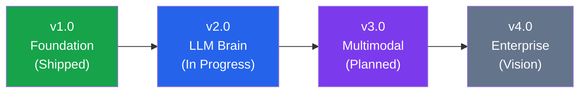
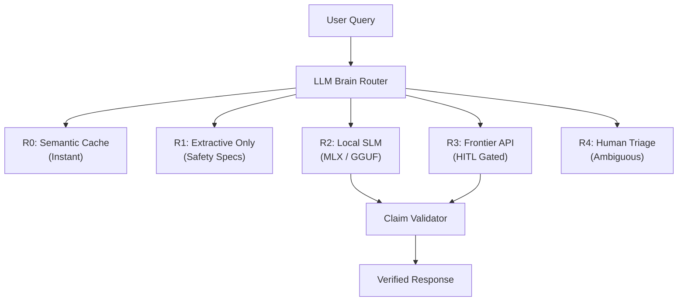

# EdgeMind Development Roadmap

> Version timeline and feature development plan for the EdgeMind (Code Cubic) platform.

---

## Version Timeline

---

## v1.0 — Foundation (Shipped)

The core offline-first industrial memory platform with zero-egress search, policy-governed sync, and conflict arbitration.

| Component | Status | Description |
|-----------|--------|-------------|
| Embedded Qdrant Edge | Done | In-process Rust vector DB with dual-shard layout (`device_memory` + `fleet_mirror`) |
| Hybrid RAG Search | Done | Dense (`BAAI/bge-small-en-v1.5`, 384-d) + Sparse (`Qdrant BM25`) with Reciprocal Rank Fusion |
| SQLite WAL State Machine | Done | ACID-compliant ledger tracking outbox, decisions, events, conflicts, cursors |
| Policy Engine | Done | Hard rules (PII regex/NER, byte budget) + soft heuristic factors (authority, dedup, novelty) |
| CRDT Conflict Engine | Done | Deterministic C1-C4 hierarchical arbitration (Authority > Version > Timestamp > Human) |
| Sync Protocol | Done | Vector clocks, outbox drain, crash recovery via `reconcile()`, air-gap link toggle |
| Next.js Console UI | Done | Industrial operator console with dual-device monitoring and hub dashboard |
| Air-Gap Invariant | Done | Zero outbound sockets during routine operations, PII auto-quarantine to `local_only` |
| 3-Tier Smart Router | Done | Local Shard -> WiFi P2P Mesh -> Fleet Cloud escalation chain |

---

## v2.0 — LLM Brain (In Progress)

Adding on-device neural reasoning with anti-hallucination safety guarantees.

### In-Progress Features

| Feature | Priority | Description |
|---------|----------|-------------|
| LLM Router (JeV Decision Engine) | P0 | Signal-based routing with R0-R4 route codes. Classifies queries by PII, connectivity, complexity, and confidence |
| Dual-Platform Local SLM | P0 | MLX engine for Apple Silicon (~40-85 tok/s), GGUF engine for Windows/Linux/CUDA (~18-50 tok/s) |
| Anti-Hallucination Claim Validator | P0 | Regex extraction of industrial metrics (torque, pressure, temp, RPM) cross-validated against source Qdrant chunks |
| Human-in-the-Loop Gate | P0 | Approval modal before any data leaves the device for frontier API calls. Full audit trail in SQLite ledger |
| Frontier API Integration | P1 | Structured JSON schema outputs from Gemini/GPT-4o. PII double-check before egress |
| Feedback Flywheel | P1 | Thumbs up/down per answer, technician corrections, DPO training data collection |
| Scalar Quantization | P1 | INT8 quantization on `fleet_mirror` shard for 4x memory savings |
| Latency Instrumentation | P1 | Stage-by-stage breakdown: `embed_dense_ms`, `embed_sparse_ms`, `qdrant_query_ms`, `rerank_ms`, `slm_ttft_ms`, `slm_decode_ms` |
| Evaluation Harness | P2 | 60-question benchmark covering specs lookup, procedures, multi-hop troubleshooting, knowledge gaps, and adversarial inputs |

### Benchmark Targets

| Metric | v1.0 Baseline | v2.0 Target |
|--------|---------------|-------------|
| Vector retrieval (10K points) | < 5ms | < 1ms |
| SLM first token (3B Q4 MLX) | N/A | < 2s |
| SLM full answer (100 tokens) | N/A | < 10s |
| Routing decision | N/A | < 100ms |
| Hallucination rate on claims | Uncontrolled | < 5% |
| Bandwidth savings (delta sync) | >= 80% | >= 99% |

---

## v3.0 — Multimodal Edge Intelligence (Planned)

Extending beyond text to vision, voice, and direct peer mesh communication.

| Feature | Description |
|---------|-------------|
| Bluetooth/WiFi Direct P2P Mesh | Direct device-to-device knowledge sharing without any internet (BLE + 802.11s ad-hoc mesh). Cave-to-cave sync |
| On-Device Vision (CLIP/MobileNet) | Snap a photo of a corroded valve or vibrating bearing; Qdrant matches against visual repair manuals |
| Offline Voice Assistant (Whisper.cpp) | Hands-free voice-to-text for field technicians with greasy gloves. Quantized 4-bit local ASR |
| Audio Spectrogram Vectors | Record pump sounds, generate FFT/AST vectors, search Qdrant for acoustic fault signatures |
| Named Vectors (Claim Vector) | Third named vector in Qdrant for claim-specific dense search alongside existing dense + BM25 |
| Qdrant Recommendation API | "Find Similar Fixes" button using Qdrant's native `recommend` endpoint |
| MMR Diversification | Maximal Marginal Relevance to prevent redundant chunk stuffing in SLM context |

---

## v4.0 — Enterprise Fleet Platform (Vision)

Scaling to production-grade multi-tenant fleet operations.

| Feature | Description |
|---------|-------------|
| Multi-Agent AI Curator Jury | Safety Agent + Duplicate Agent + Auto-Drafter Agent committee for cloud-side knowledge verification |
| End-to-End Encryption (E2EE) | ChaCha20-Poly1305 device-level encryption with zero-knowledge cloud routing |
| Vector Delta Compression | 16-byte quantized delta patches for 98% payload compression over Iridium satellite radios |
| Multi-Tenant Partitioning | Cryptographic namespace separation (`TenantID/SiteID/AssetType`) with contractor access controls |
| Binary Quantization | Float32 to 1-bit (32x memory savings) enabling Qdrant on $5 ESP32-S3 microcontrollers |
| AR Safety Glasses | Stream Qdrant search results to HoloLens / Apple Vision Pro overlays for guided field repairs |
| Automated Knowledge Pruning | Recency decay curves and tombstone propagation when assets are decommissioned |
| Qdrant Cloud Hub | Migrate central hub from Docker Qdrant to Qdrant Cloud managed cluster |

---

## Hardware Tier Support Matrix

| Tier | Device | RAM | Capability | SLM Model |
|------|--------|-----|------------|-----------|
| C | MacBook M-series | 16GB+ | Full SLM (7B MLX) | Qwen2.5-7B-Instruct-4bit |
| B | Industrial Tablet | 4-8GB | Standard SLM (3B GGUF) | Qwen2.5-3B-Q4_K_M |
| A | Raspberry Pi 4 | 2-4GB | RAG only (no SLM) | N/A — extractive only |
| Embedded | MCU / ESP32 | < 1GB | Vector search only | N/A |

---

## Contributing

We welcome contributions at every level. See the main [README](README.md) for setup instructions and contribution guidelines.

Priority contribution areas:
- **v2.0 Brain:** Claim validation patterns for new industrial domains
- **v3.0 Multimodal:** Vision model integration and audio fingerprinting
- **Testing:** Expanding the evaluation benchmark question set
- **Documentation:** API reference guides and deployment tutorials
